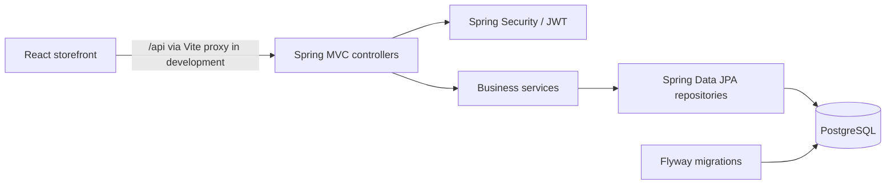

# ShopEasy

A full-stack ecommerce application built with **Java 21, Spring Boot 4, PostgreSQL, React 19, and Vite**. Customers can browse products, manage a cart, and place and track orders. Administrators can manage the catalog and order fulfilment from the same web app.

The React storefront communicates with the Spring Boot API for authentication, products, carts, and orders.

## What is implemented

| Area | Features |
| --- | --- |
| Storefront | Responsive catalog, search, category and price filters, sorting, product details and images, English/Arabic layout, light/dark themes |
| Accounts | Registration and login with signed JWTs; account details from the API; customer and administrator roles |
| Cart and orders | Persistent per-user cart, stock-aware checkout, order history and details, cancellation before shipping |
| Administration | Create, edit, deactivate, and upload images for products; view orders and advance their status |
| Backend quality | Request validation, consistent error responses, DTOs, service layer, transactions, database migrations, and automated tests |

The wishlist is stored **in the browser**, per account, because there is no wishlist API yet. Prices are displayed as USD for this demo. Checkout creates an order and adjusts stock; it does not collect payment or arrange delivery.

## Architecture



The frontend keeps HTTP calls and Java response mapping in `frontend/src/api/client.js`. React Query manages server data, while contexts hold session and cart state. On the backend, controllers validate requests and return DTOs; services enforce business rules and transactions; repositories handle persistence. Flyway creates the schema and Hibernate validates it on startup.

### Key backend decisions

- Passwords use BCrypt. The API uses stateless bearer JWT authentication; public registration always creates a customer account.
- Checkout locks product rows in a stable order, checks stock again, stores price and product-name snapshots in order items, reduces stock, and clears the cart in one transaction.
- Cancelling a placed order restores stock. Deactivating a product preserves order history.
- Errors use a consistent JSON response with an HTTP status and readable message.

## Run locally

### Requirements

- Java 21
- PostgreSQL
- Node.js compatible with Vite 8 (Node 20.19+ or 22.12+)

### 1. Database and backend

Create a PostgreSQL database named `shopeasy`. Copy `Backend/.env.example` to `Backend/.env` and set the database credentials, a Base64 encoded random JWT key of at least 32 bytes, and admin credentials. `Backend/.env` is ignored by Git. The database user must be able to create the `shopeasy_app` schema on first run.

From `Backend/`:

```powershell
.\mvnw.cmd spring-boot:run
```

The IDE can also launch `ShopEasyApplication` with the repository root as its working directory; both locations load `Backend/.env` correctly.

The API starts on `http://localhost:8080`. Flyway creates the `shopeasy_app` schema. Log in with the configured `ADMIN_EMAIL` and `ADMIN_PASSWORD` to add the first products.

### 2. Frontend

From `frontend/` in a second terminal:

```powershell
npm install
npm run dev
```

Open the local URL printed by Vite (usually `http://localhost:5173`). The Vite development server proxies `/api` to `http://localhost:8080`, so no browser CORS setup is needed. On Windows PowerShell, use `npm.cmd` if script execution blocks `npm.ps1`.

An optional `frontend/.env.local` can set `VITE_API_BASE_URL` when the API is hosted on a different origin. Use only public, browser-safe values in Vite environment files.

### 3. Try the full flow

1. Sign in with the admin credentials and create an active product with stock in **Store management**. You can upload a PNG, JPEG, or WebP image (up to 2 MB).
2. Sign out, create a customer account, and browse the catalog.
3. Add a product to the cart and place an order. The order appears under **Orders**, and available stock decreases.
4. Cancel it while its status is **Placed**; stock is restored.
5. Sign back in as admin and move another placed order to **Shipped**, then **Delivered**.

## API overview

| Access | Endpoints |
| --- | --- |
| Public | `POST /api/auth/register`, `POST /api/auth/login`, `GET /api/products`, `GET /api/products/categories`, `GET /api/products/{id}` |
| Customer | `GET /api/users/me`, `/api/cart` and `/api/cart/items`, `/api/orders` and `/api/orders/{id}`, `PATCH /api/orders/{id}/cancel` |
| Admin | `POST/PUT/DELETE /api/products`, `PUT /api/products/{id}/image`, `GET /api/admin/products`, `GET /api/admin/orders`, `PATCH /api/admin/orders/{id}/status` |

Protected requests use `Authorization: Bearer <accessToken>`. Product and order lists are paginated. See [backend API details](Backend/README.md) and [frontend details](frontend/README.md).

## Checks

```powershell
# In Backend/
.\mvnw.cmd test

# In frontend/
npm run lint
npm run build
```

Backend tests cover the customer purchase and cancellation flow, role checks, JWT handling, and order rules. Docker packaging is planned as the final project step.
